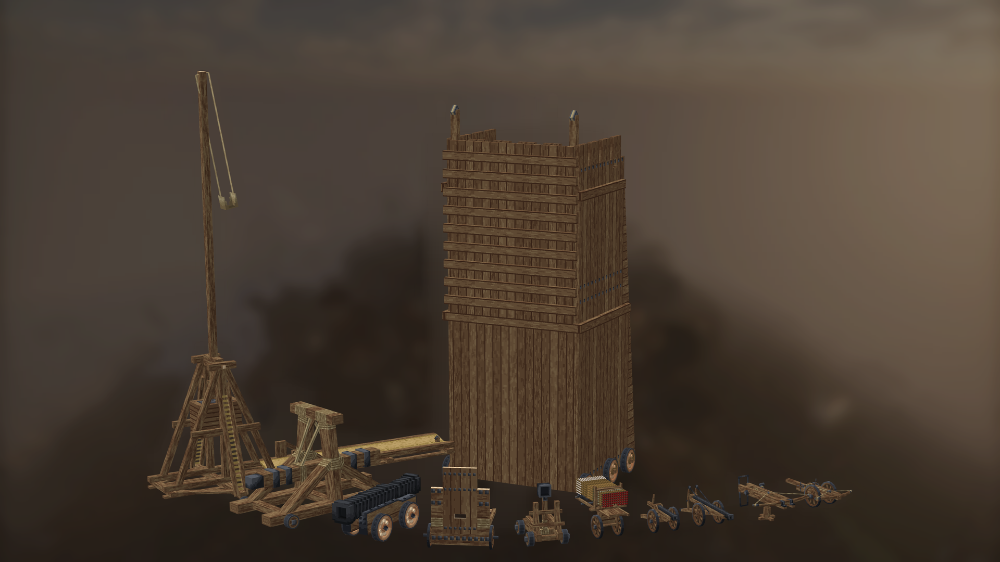

Siegeworks adds medieval siege engines for field battles and assaults on fortifications: cannons, bolt throwers, stone throwers, a hwacha, a battering ram, a mantlet, siege ladders and a siege tower.

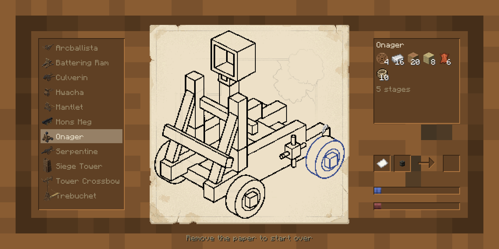

Most machines begin with a blueprint drawn at the drawing table. Place the blueprint in the world, bring the required materials and build the machine section by section with a construction hammer. Completed machines can be repaired or dismantled. Siege ladders are crafted and extended to the length you need.

Artillery is loaded manually, with each weapon using its own ammunition, tools and loading sequence. Aim from the operator's position, and adjust the tension of bolt throwers and stone throwers to control the shot. Projectiles have different trajectories and effects on impact: they damage entities, penetrate some blocks and gradually break through structures with repeated hits. Compatible wheeled machines can be towed by draft mounts.

## Siege engines

View all siege engines

### Tower Crossbow

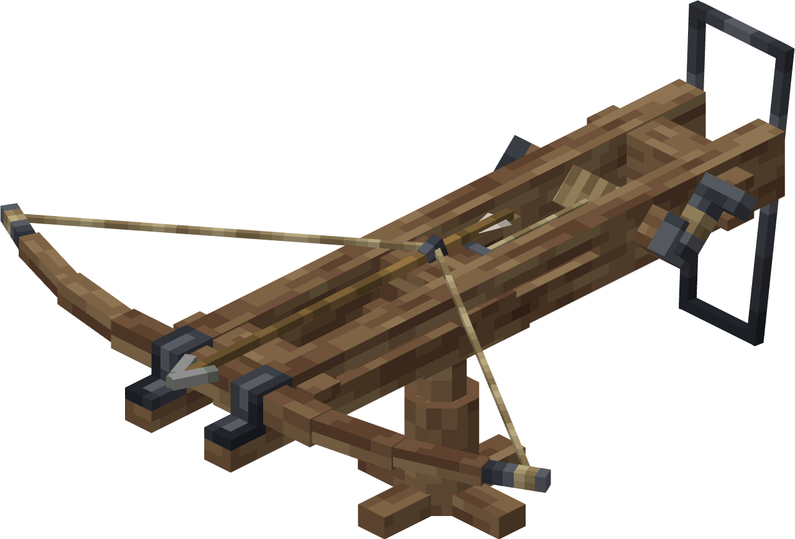

A stationary heavy crossbow with full horizontal traverse.

### Arcballista

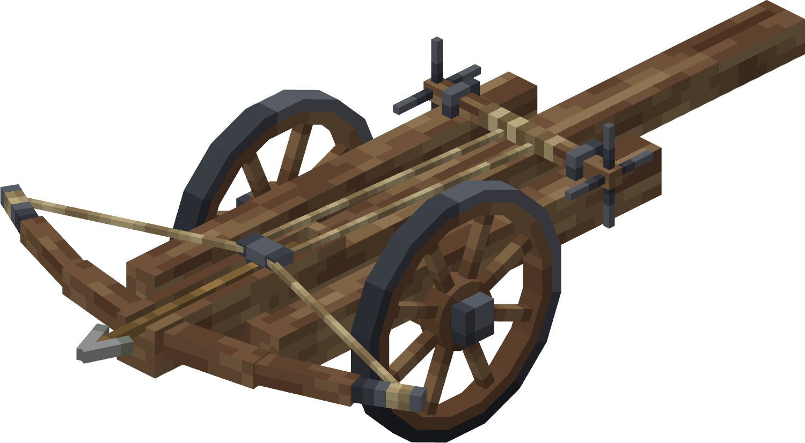

A wheeled bolt thrower that can be operated directly or towed by a draft mount.

### Culverin

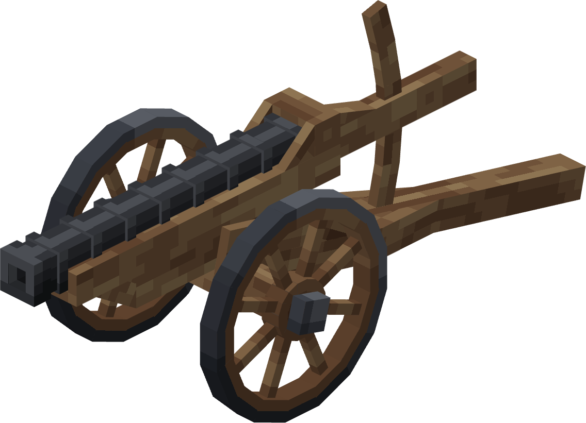

A light field gun firing cannon balls or grapeshot.

### Serpentine

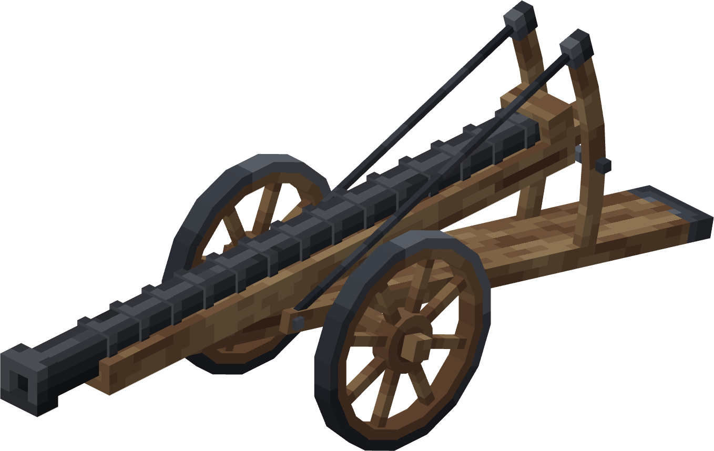

A larger field gun using a heavier powder charge.

### Mons Meg

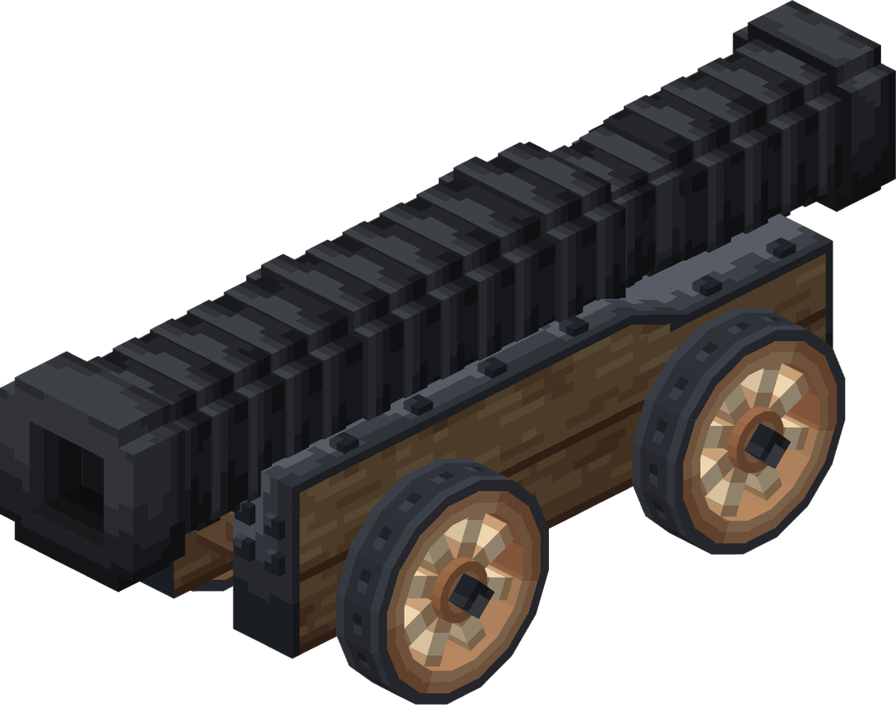

A heavy bombard firing giant cannon balls or grapeshot.

### Onager

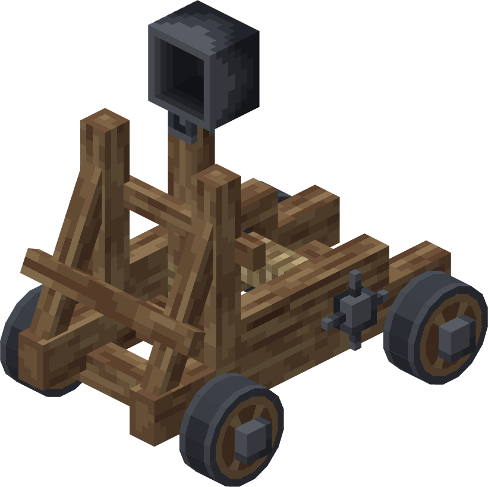

A mobile torsion stone thrower for stones, incendiary projectiles and stone grapeshot.

### Trebuchet

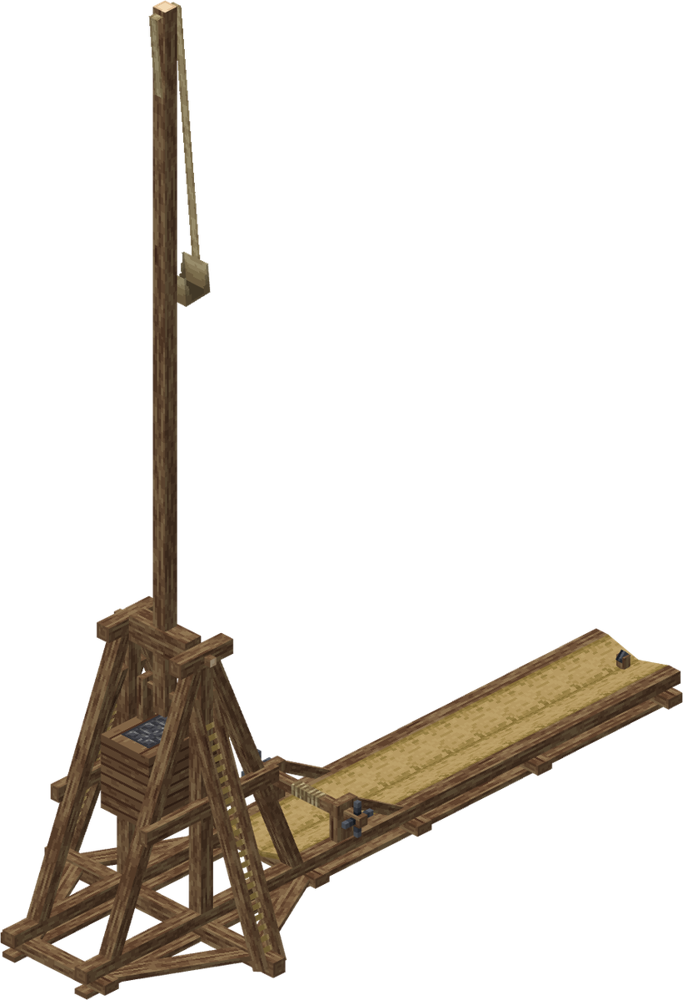

A large stationary stone thrower using the same ammunition types as the onager.

### Hwacha

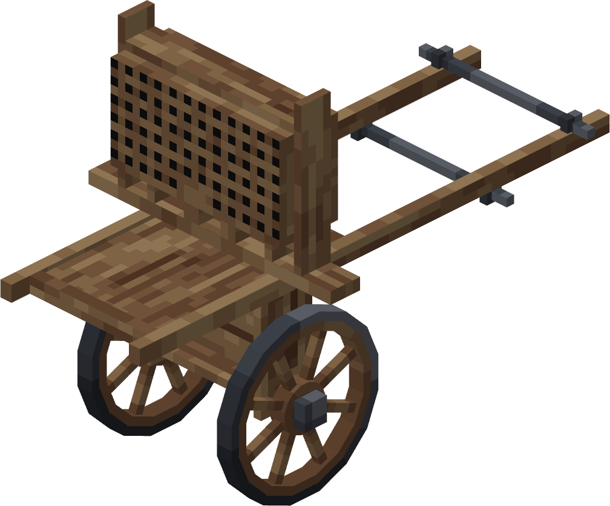

A wheeled launcher holding up to 70 standard or explosive Singijeon rockets.

### Battering Ram

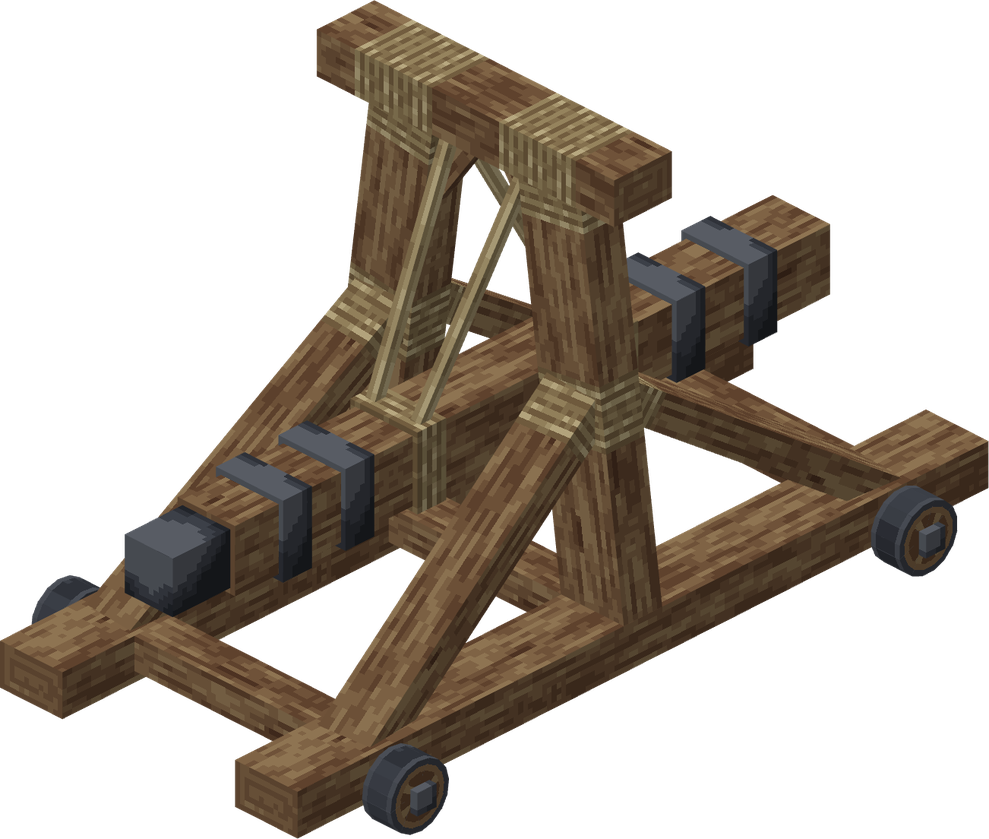

A heavy machine for breaking walls and gates. It can be moved by a crew or towed by a draft mount.

### Mantlet

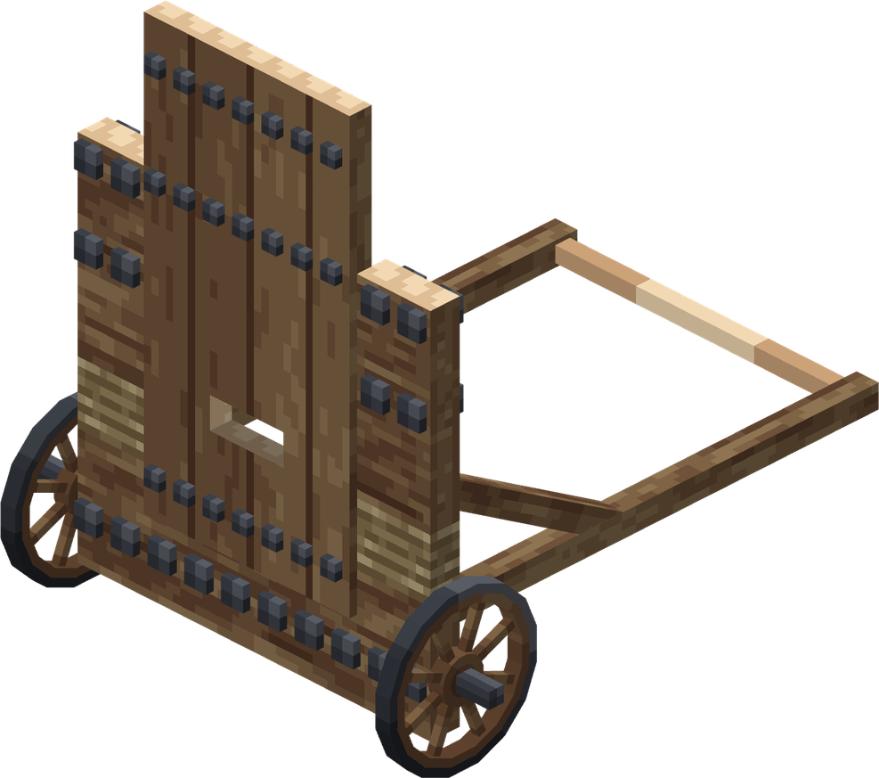

A movable shield with an opening shutter.

### Siege Ladder

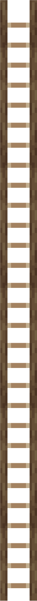

A ladder crafted to length, providing a route onto walls for players and compatible NPCs. Defenders can brace a forked pole against its top and push it off the wall.

### Siege Tower

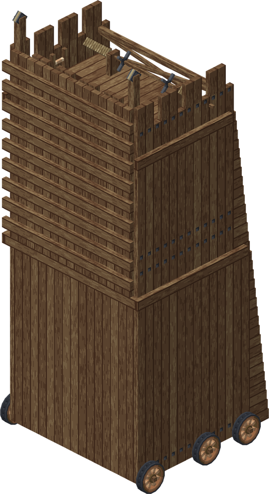

A three-floor tower with internal ladders, a controllable drawbridge and places for its crew and assault troops.

## Recruits integration

[Villager Recruits](https://modrinth.com/mod/villager-recruits) can build, supply, repair, dismantle and operate siege engines. Siege commands are available in the regular Recruits command menu: select one or more squads, open the siege category and choose a machine type operated by those squads.

The integration supports Forge 1.20.1 and NeoForge 1.21.1 with a compatible Recruits build. The NeoForge integration is developed against the [multiloader port](https://github.com/mess1re/recruits/tree/stonecutter-multiloader).

On Forge 1.20.1, [Recruits RTS Command](https://www.curseforge.com/minecraft/mc-mods/recruits-rts-command) adds control from the tactical map, including movement orders and fire zones.

## Required dependencies

- [Axiomata](https://www.curseforge.com/minecraft/mc-mods/axiomata)
- [GeckoLib](https://modrinth.com/mod/geckolib)
- [Architectury API](https://modrinth.com/mod/architectury-api)
